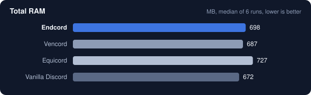
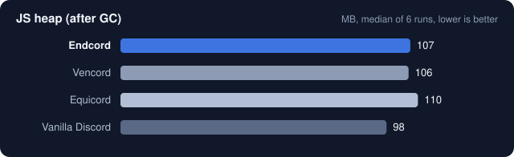
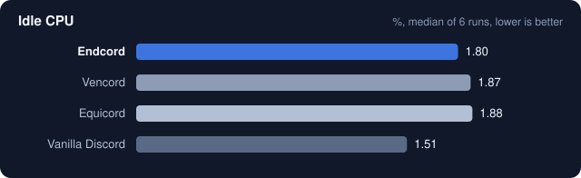
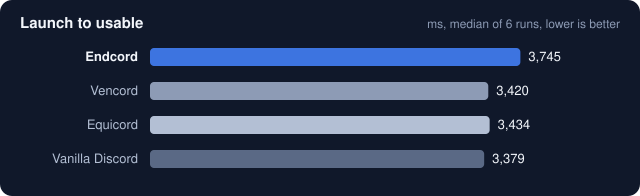

# Endcord performance benchmark

How much does a client mod cost you? This folder holds a reproducible, head-to-head measurement of
**Endcord**, **Vencord** and **Equicord** against **unmodified Discord**, on the same machine and
the same Discord build.

## Results

Endcord ships **500 plugins** in five languages, nearly three times as many as Vencord (178) and more
than Equicord (381). Every count is the full list a mod registers, including the internal API plugins
it uses to build its other plugins. With all of that on board it runs in **the same memory as
Vencord** (within 2%, inside the run-to-run noise), uses **less memory than Equicord** on every
measure, and has the **lowest idle CPU** of the three mods.

| Metric | Endcord | Vencord | Equicord | Vanilla Discord |
|---|---:|---:|---:|---:|
| Plugins shipped | **500** | 178 | 381 | – |
| Total RAM (MB) | 698 | **687** | 727 | 672 |
| Renderer RAM (MB) | 401 | **397** | 415 | 366 |
| JS heap after GC (MB) | 107 | **106** | 110 | 98 |
| Idle CPU (% of one core) | **1.80** | 1.87 | 1.88 | 1.51 |
| Launch to usable (ms) | 3,745 | **3,420** | 3,434 | 3,379 |
| CPU time, first 30 s (ms) | 29,219 | 28,446 | **28,313** | 28,508 |
| DOM nodes | 3,701 | **3,674** | 3,696 | 3,659 |
| CSS rules | **35,294** | 35,357 | 36,946 | 34,891 |

Medians of 6 cold launches per variant; bold marks the best mod in each row. Every run is in
[`results/`](results).

<p align="center">
  <br>
  <br>
  <br>
  
</p>

### Reading the numbers

- **Memory:** Endcord adds about 26 MB over vanilla Discord, Vencord about 15 MB and Equicord about
  55 MB. The spread between single runs of the same variant is larger than the gap between Endcord
  and Vencord (Endcord ranged from 631 to 727 MB, Vencord from 633 to 708 MB).
- **Idle CPU:** all three mods are within a few tenths of a percent of each other. Most idle work
  comes from Discord itself (animated name styles, activity cards), not from the mods.
- **Startup:** Endcord's renderer bundle is 5.1 MB, against 3.1 MB for Equicord and 0.7 MB for
  Vencord: 500 plugins and five full translations are code that has to be read. That costs Endcord
  roughly 0.3 s of launch time against Vencord. Plugins are only evaluated when they are turned on,
  so the bundle size does not grow memory at the same rate.
- **Plugins are off until you turn them on.** The numbers above are with default settings in every
  mod. Each plugin you enable costs something, in any mod.

## Test machine

| | |
|---|---|
| CPU | Intel Core i5-12400F (6 cores, 12 threads) |
| RAM | 32 GB |
| GPU | NVIDIA GeForce RTX 3080 |
| Storage | SSD |
| OS | Windows 10 Home 10.0.19045, Balanced power plan |
| Discord | Stable 1.0.9265 |
| Runner | Node.js 22.14.0 |
| Date | 23 October 2026 |

Bundle sizes as installed: Endcord `renderer.js` 5,112 KB, Equicord 3,061 KB, Vencord 693 KB. Full
details, including file hashes, are in [`results/system.json`](results/system.json).

## Method

Every number comes from [`run-benchmark.mjs`](run-benchmark.mjs). It is short and has no
dependencies, so you can read exactly what it does and run it yourself.

- **Same Discord, same account.** All four variants run on one Discord Stable install. The script
  swaps the one-line loader in `resources\app\index.js` between runs, so the mod is the only thing
  that changes. Running each mod on a different Discord channel (Canary, PTB) would also compare
  different Discord builds.
- **Default settings.** Each mod's settings folder is moved aside for the run and restored
  afterwards, so every mod starts the way a new user would get it.
- **Cold launches.** Discord is killed and relaunched for every measurement.
- **Interleaved rounds.** Each round runs every variant once, and the starting variant rotates from
  round to round, so background noise and warm disk caches are spread evenly.
- **Checked screens.** A screenshot is saved locally at the moment of measurement (`results/screens/`,
  not committed because it shows the account used), so a dialog or an error screen cannot skew a run
  unnoticed.
- **Medians.** Tables and charts show the median of all rounds; `results/` keeps every run.

What each metric means:

| Metric | How it is measured |
|---|---|
| Total RAM | Private memory of all Discord processes, 120 s after launch |
| Renderer RAM | Private memory of the window's renderer process |
| JS heap | Used JavaScript heap of the Discord window, after a forced garbage collection |
| Idle CPU | CPU time of all Discord processes between 60 s and 120 s after launch, as a share of one core, with Discord left untouched on the Friends page |
| Launch to usable | From starting `Discord.exe` until the server list and channel sidebar are on screen |
| CPU time, first 30 s | CPU time of all Discord processes during startup |
| DOM nodes, CSS rules | Size of the page after startup; mods add styles and elements |

## Run it yourself

Requirements: Windows, Discord Stable (logged in), Node.js 22 or newer, and the mods you want to
compare installed in their usual `%APPDATA%` folders.

```bash
node benchmark/run-benchmark.mjs --rounds 6 --duration 120
node benchmark/summarize.mjs
```

Close Discord first and leave the PC alone while it runs, about 2 minutes per launch. The original
loader and every mod's settings are restored when the script finishes, also when it fails. Pass
`--mods endcord,vanilla` to compare a subset.

## Caveats

- One machine, one account. Absolute numbers will differ on your PC; the gaps between variants are
  what this shows.
- Mods are measured with default settings. Plugins you enable add their own cost.
- Idle CPU is a small number and sensitive to anything else happening on the PC, which is why it is
  measured over a full minute and reported as a median.
